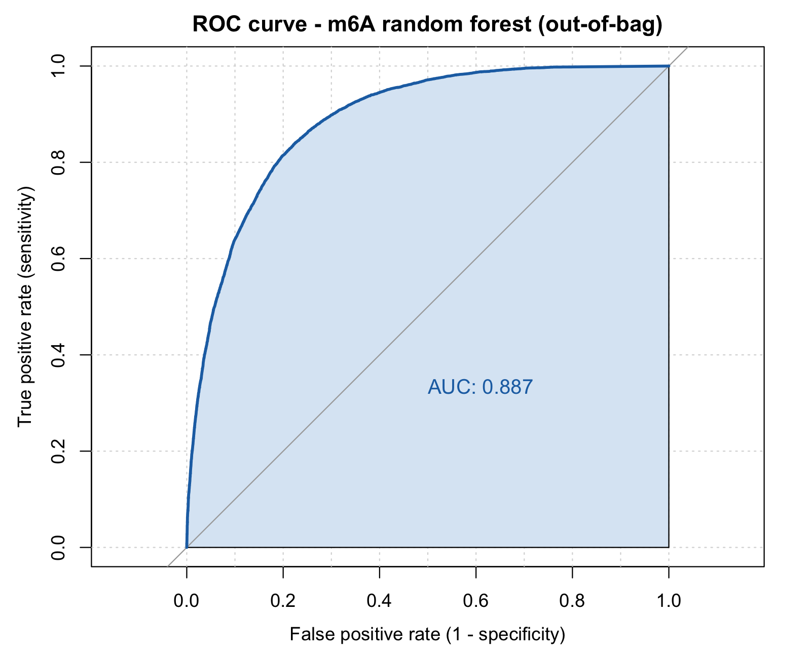
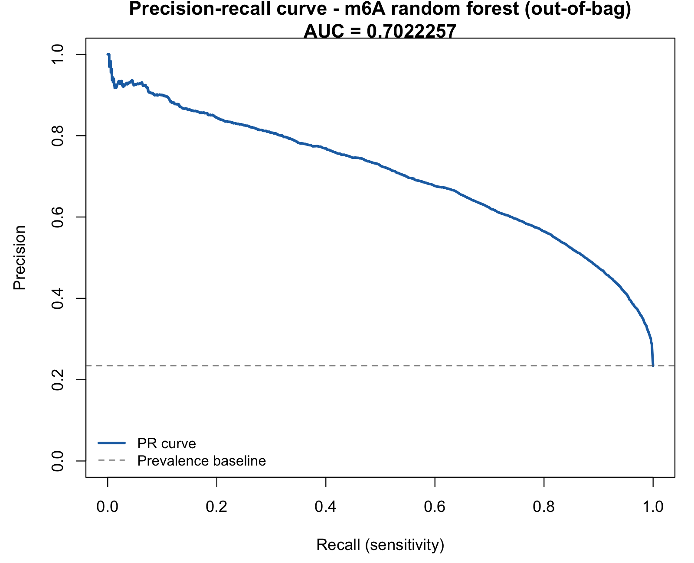

# m6APrediction

**Sequence-based prediction of N6-methyladenosine (m6A) sites using a random forest model**

`m6APrediction` predicts whether a candidate RNA site carries an
N<sup>6</sup>-methyladenosine (m6A) modification, using only information that
can be read off the transcript sequence and annotation: GC content, RNA type,
RNA region, exon length, distance to the nearest exon junction, evolutionary
conservation of the 5-mer context, and the DNA 5-mer itself.

The package is the deliverable of the BIO215 bioinformatics project. It
packages the random forest model developed in Practical 4 and the prediction
functions written in Practical 5 into a documented, installable R package, so
that the same model can be reused from any R session instead of living inside
a single Shiny app.

---

## Why a sequence-based m6A predictor is useful

m6A is the most abundant internal modification of eukaryotic mRNA. It is
deposited by the METTL3–METTL14 writer complex, recognised by reader proteins
such as YTHDF1–3, and influences transcript stability, splicing and
translation. Mapping m6A experimentally (MeRIP-seq, miCLIP, GLORIP) is
expensive, needs large amounts of RNA, and gives antibody-dependent,
region-level resolution.

Because the modification is enriched in a DRACH-type motif and correlates
strongly with local sequence composition, exon architecture and evolutionary
conservation, a model trained on those features can rank candidate sites
before any wet-lab work. That is what this package provides: a fast,
interpretable scoring function that turns a feature table — or a single 5-mer
context — into a probability and a Positive/Negative call.

---

## Installation

The package is hosted on GitHub. Install it with `devtools` (or `remotes`
if you prefer a lighter dependency):

```r
# install.packages("devtools")
devtools::install_github("Zzty2026/m6APrediction")

# or, without devtools
# install.packages("remotes")
remotes::install_github("Zzty2026/m6APrediction")
```

The package requires R (>= 3.5.0) and imports `randomForest` and `stats`.
The fitted model (about 15 MB) and a 100-row example feature table are
bundled with the package, so no external download is needed.

---

## Quick start

```r
library(m6APrediction)

# 1. Load the bundled model and example feature table
ml_fit <- readRDS(system.file("extdata", "rf_fit.rds",
                              package = "m6APrediction"))
example_df <- read.csv(system.file("extdata", "m6A_input_example.csv",
                                   package = "m6APrediction"))

# 2. Score many candidate sites at once
res <- prediction_multiple(ml_fit, example_df[1:5, ],
                           positive_threshold = 0.6)
res[, c("DNA_5mer", "predicted_m6A_prob", "predicted_m6A_status")]
#>   DNA_5mer predicted_m6A_prob predicted_m6A_status
#> 1    GAACA              0.876             Positive
#> 2    GAACC              0.000             Negative
#> 3    AAACT              0.498             Negative
#> ...

# 3. Score one site without building a data.frame
prediction_single(ml_fit,
                  gc_content = 0.6, RNA_type = "mRNA", RNA_region = "CDS",
                  exon_length = 12, distance_to_junction = 5,
                  evolutionary_conservation = 0.8, DNA_5mer = "GGACA")
#>  predicted_m6A_prob predicted_m6A_status
#>               "0.51"            "Positive"
```

Note that `exon_length` and `distance_to_junction` are expected
**already log2-transformed**, and that `DNA_5mer` must be a five-nucleotide
context with a central adenine (e.g. `GGACA`). The returned status is
`"Positive"` only when the probability is **strictly greater** than the
threshold; a probability equal to the threshold counts as `"Negative"`.

---

## Functions

| Function | Exported | Purpose |
|---|---|---|
| `prediction_multiple(ml_fit, feature_df, positive_threshold = 0.5)` | yes | Score a table of candidate sites; returns the input columns plus `predicted_m6A_prob` and `predicted_m6A_status`. |
| `prediction_single(ml_fit, gc_content, RNA_type, RNA_region, exon_length, distance_to_junction, evolutionary_conservation, DNA_5mer, positive_threshold = 0.5)` | yes | Score one site from individual feature values; returns a named character vector. |
| `dna_encoding(dna_strings)` | no (internal) | Expand 5-mer strings into five positional nucleotide factors (`nt_pos1`–`nt_pos5`) on the fixed levels A, T, C, G. |

Full help pages are available in R, e.g. `?prediction_multiple`,
`?prediction_single` and `?dna_encoding`.

---

## Model performance

Performance of the random forest model, computed from the out-of-bag (OOB)
votes of the fitted forest — i.e. predictions for each site made by the trees
that did **not** see it during training, which is equivalent to a held-out
evaluation:

**ROC curve**



**Precision–recall curve**



The ROC curve stays well above the diagonal and the precision–recall curve
remains high across the recall range, which is the more informative view for
this problem: m6A sites are a minority class, so a high overall accuracy
would be misleading, whereas precision at high recall is what matters when
the model is used to prioritise sites for experimental validation.

Reported performance: **AUC = 0.89**; **PRC-AUC = 0.70**
(4,805 negatives vs 11,248 positives in the training votes; the minority class
is the positives, which is why PRC rather than ROC is the headline metric).

---

## Package contents

```
m6APrediction/
├── DESCRIPTION
├── NAMESPACE
├── LICENSE
├── R/
│   └── main.R                 # the three functions + roxygen2 documentation
├── man/                       # .Rd help pages generated by roxygen2
├── inst/
│   └── extdata/
│       ├── rf_fit.rds         # fitted random forest model (15 MB)
│       └── m6A_input_example.csv  # 100 example sites × 7 features
├── man/figures/               # ROC and PRC plots shown above
└── README.md
```

---

## Reproducibility

```r
devtools::document()          # regenerate NAMESPACE and man/*.Rd
devtools::load_all()          # load the development version
devtools::check(args = "--no-manual")   # full package check
```

`devtools::check()` runs both worked examples from the help pages. The
examples load the bundled model themselves, so they also run in a fresh
R session after installation.

---

## Data

`m6A_input_example.csv` contains 100 candidate sites and the seven features
used by the model. It is an **illustrative** table for demonstrating and
testing the functions, not an independent test set, so it must not be used
to estimate prediction accuracy.

---

## License

MIT. See `LICENSE` and `LICENSE.md`.

---

## Acknowledgements

Developed for the BIO215 Bioinformatics Project. The model, the feature
definitions and the original prediction functions come from Practicals 4 and
5 of the module.
